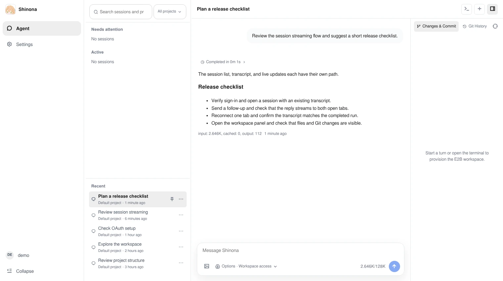

<p align="center">
  
</p>
<h3 align="center">Shinona</h3>
<p align="center">A self-hosted web app for running pi-go agents in E2B workspaces.</p>

<p align="center">
  <a href="README.md">English</a> · <a href="README_zh.md">简体中文</a>
</p>

<p align="center">
  <a href="docs/guide.md">Documentation</a> · <a href="#quick-start">Quick Start</a> · <a href="CONTRIBUTING.md">Contributing</a>
</p>

<p align="center">
  <a href="go.mod"></a>
  <a href="web/package.json"></a>
  <a href="LICENSE"></a>
</p>

## Preview



## Features

- Organize multi-turn conversations by project and stream agent replies and tool output as they arrive.
- Share an E2B workspace across each project's sessions, with interactive terminals, files, and Git changes.
- Connect an OpenAI-compatible model endpoint and select MCP servers in the composer.
- Sign in with a password or OpenID Connect and use the UI in English, Simplified Chinese, or Traditional Chinese.

## Quick Start

Install Go 1.26.2 or later, a C compiler for SQLite, and Node.js 24 with npm. Node.js 22.13 or later in the 22.x series also works.

1. From the checkout root, create a password account. Copy the account ID printed by `create-user`, use it in place of `USER_ID`, and start the API.

   ```sh
   go run ./cmd/shinona create-user you@example.test
   go run ./cmd/shinona grant-admin USER_ID
   go run ./cmd/shinona
   ```

2. In a second terminal, install the web dependencies and start the frontend.

   ```sh
   npm --prefix web ci
   npm --prefix web run dev
   ```

3. Sign in at [http://127.0.0.1:5173](http://127.0.0.1:5173).
4. In **Settings → Model**, set an OpenAI-compatible base URL and API key. Fetch the model list and select a default model.
5. In **Settings → Sandbox**, set the E2B API key. For self-hosted E2B, also set its control-plane URL.

See the [guide](docs/guide.md) for LAN preview, single sign-on, MCP, and workspace configuration. [.env.example](.env.example) lists the startup variables.

## Star History

[](https://www.star-history.com/#OXeu/shinona&Date)

## LICENSE

Shinona uses the [Apache License 2.0](LICENSE).
