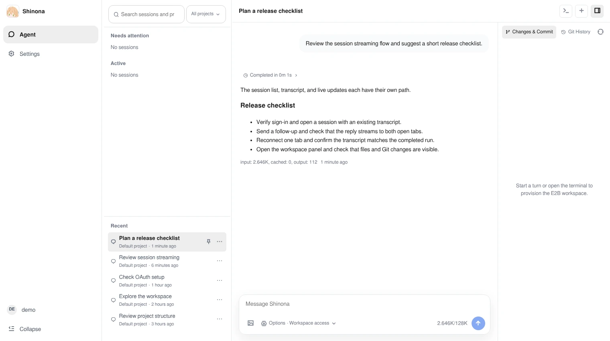

<p align="center">
  
</p>
<h3 align="center">Shinona</h3>
<p align="center">Shinona 是一款可自托管的 Web 应用，用于在沙箱工作区中运行 <a href="https://github.com/sky-valley/pi">pi</a> 智能体。</p>

<p align="center">
  <a href="README.md">English</a> · <a href="README_zh.md">简体中文</a>
</p>

<p align="center">
  <a href="docs/guide.md">使用指南（英文）</a> · <a href="#快速开始">快速开始</a> · <a href="CONTRIBUTING.md">贡献指南（英文）</a>
</p>

<p align="center">
  <a href="go.mod"></a>
  <a href="web/package.json"></a>
  <a href="LICENSE"></a>
</p>

## 预览



## 功能

- 按项目管理多轮会话，实时查看智能体回复和工具输出。
- 同一项目的会话共享 E2B 工作区，可使用交互式终端、浏览文件和查看 Git 变更。
- 接入 OpenAI 兼容的模型接口，并在输入区选择 MCP 服务。
- 支持密码和 OpenID Connect 登录，界面提供英语、简体中文和香港繁体中文。

## 快速开始

安装 Go 1.26.2 或更高版本、用于编译 SQLite 的 C 编译器，以及带 npm 的 Node.js 24。Node.js 22 系列需使用 22.13 或更高版本。

1. 在仓库根目录创建密码账户。复制 `create-user` 输出的账户 ID，替换 `USER_ID`，再启动 API。

   ```sh
   go run ./cmd/shinona create-user you@example.test
   go run ./cmd/shinona grant-admin USER_ID
   go run ./cmd/shinona
   ```

2. 在另一个终端中安装前端依赖并启动前端。

   ```sh
   npm --prefix web ci
   npm --prefix web run dev
   ```

3. 打开 [http://127.0.0.1:5173](http://127.0.0.1:5173) 并登录。
4. 在**设置 → 模型**中填写 OpenAI 兼容的 API 地址和密钥。获取模型列表后，选择默认模型。
5. 在**设置 → 沙箱**中填写 E2B API 密钥。使用自托管 E2B 时，还需填写控制平面地址。

局域网预览、单点登录、MCP 和工作区配置见[使用指南（英文）](docs/guide.md)。启动环境变量见 [.env.example](.env.example)。

## 星标历史

[](https://www.star-history.com/#OXeu/shinona&Date)

## 许可证

Shinona 采用 [Apache License 2.0](LICENSE)。
